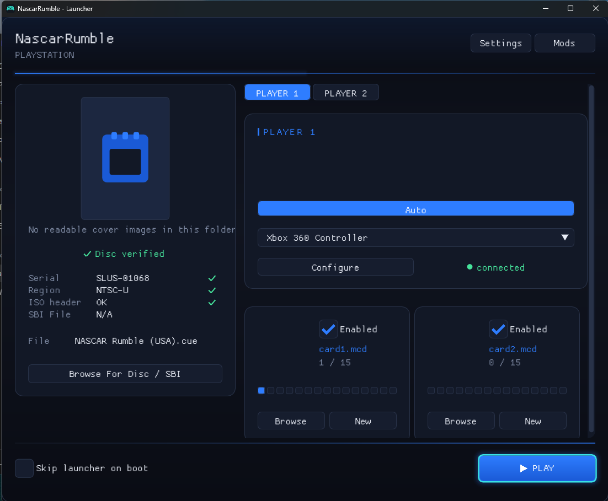
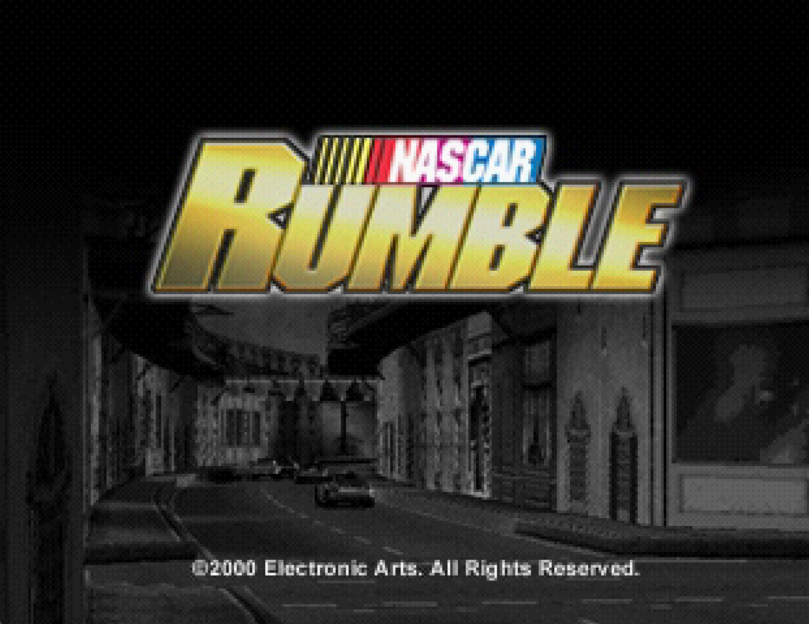
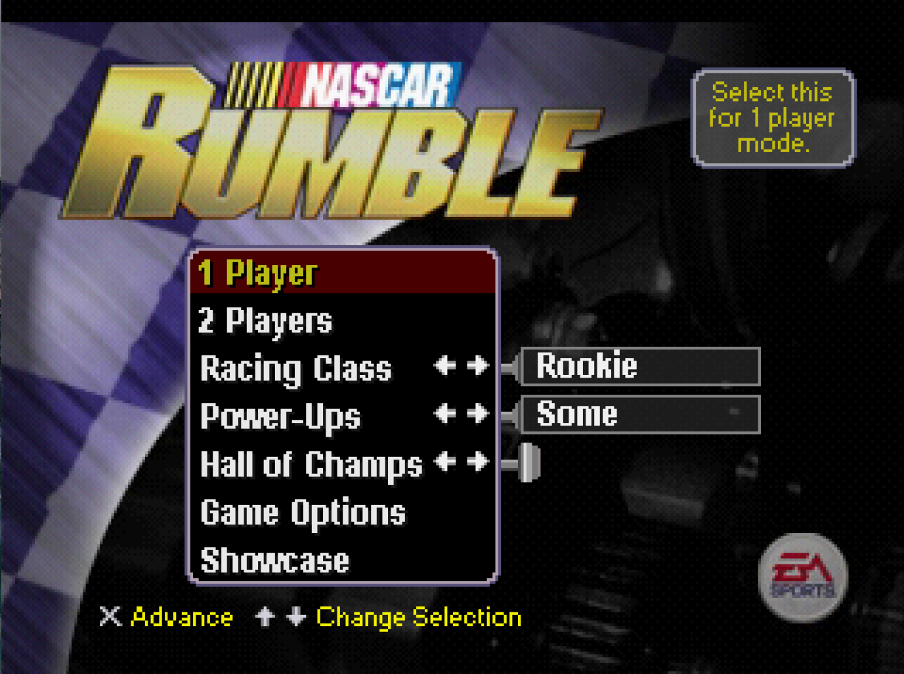
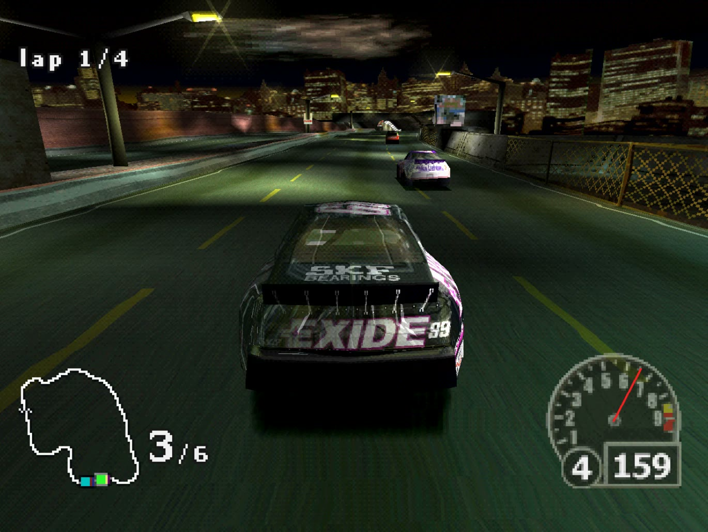
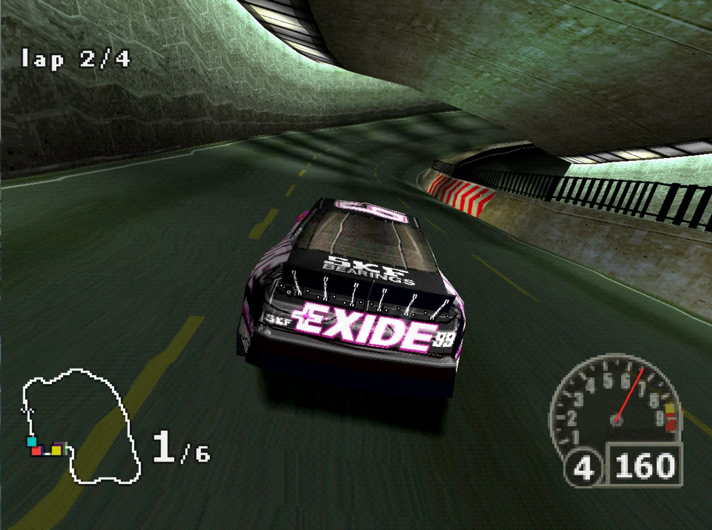

# NASCAR Rumble Recompiled

Port nativo para Windows do **NASCAR Rumble (PlayStation, USA, SLUS-01068)**, feito por
**recompilação estática** com o [psxrecomp](https://github.com/mstan/psxrecomp). O executável
do PS1 é traduzido para C e compilado como um programa nativo do PC, sem emular a CPU.

<p align="center">
  
</p>

| Tela de título | Menu principal |
|---|---|
|  |  |
| **Corrida noturna na cidade** | **Corrida no túnel** |
|  |  |

## Recursos

- Executável nativo para Windows (64 bits)
- Todo o código do jogo é compilado na instalação: o NASCAR Rumble não carrega trechos de
  código do disco durante a corrida, então não há engasgos de compilação
- Launcher com verificação do disco, configuração de controles e memory cards virtuais
- **2 jogadores locais** em tela dividida (controles Xbox, DualShock e DualSense)
- Opções de vídeo do psxrecomp (resolução interna maior, widescreen)

---

## Como instalar (passo a passo)

São **5 passos**. Você só faz isso uma vez.

### Passo 1: tenha a imagem do SEU disco

Este repositório **não contém o jogo**. Você precisa da imagem do seu próprio disco de
**NASCAR Rumble (USA)** no formato **BIN/CUE**: são dois arquivos, um `.bin` e um `.cue`, que
devem ficar juntos na mesma pasta.

- Para criar a imagem a partir do seu CD, siga o
  [guia de dump do Redump](http://wiki.redump.org/index.php?title=Dumping_Guides).
- A imagem precisa ser exatamente esta (o jogo confere na hora de abrir):

  | Campo | Valor esperado |
  |---|---|
  | Serial | SLUS-01068 |
  | Tamanho do `.bin` | 261.248.400 bytes |
  | SHA1 do `.bin` | `3e43fedad31a67400808e816ed28a52fb6ec0381` |

- Se sua imagem estiver em **CHD**, converta para BIN/CUE com o `chdman` (vem com o MAME):

  ```bash
  chdman extractcd -i "NASCAR Rumble.chd" -o "NASCAR Rumble (USA).cue" -ob "NASCAR Rumble (USA).bin"
  ```

> Guarde a imagem numa pasta fixa, por exemplo `C:\Jogos\NASCAR Rumble (USA)\`.
> O jogo lê o disco dessa pasta toda vez que abre, então não mova nem apague a imagem depois.

### Passo 2: instale o Git e o Python

1. Clique com o botão direito no **menu Iniciar** e escolha **Terminal** (ou **Windows PowerShell**).
2. Cole este comando e aperte **Enter**:

   ```powershell
   winget install Git.Git Python.Python.3.12
   ```

3. Aceite o que for pedido e espere terminar.
4. **Feche a janela do PowerShell e abra uma nova.** Sem isso, os comandos novos não são reconhecidos.

> Já tem Git e Python instalados? Pode pular este passo.

### Passo 3: baixe este projeto

No PowerShell novo, cole os dois comandos abaixo, um de cada vez, apertando **Enter** depois de cada um:

```powershell
cd $HOME\Downloads
```

```powershell
git clone https://github.com/lleandroRodrigzz/NascarRumbleRecomp.git
```

Isso cria a pasta `Downloads\NascarRumbleRecomp`.

### Passo 4: rode o instalador

Ainda no PowerShell, cole:

```powershell
cd NascarRumbleRecomp
```

```powershell
powershell -ExecutionPolicy Bypass -File setup.ps1
```

1. Vai abrir uma janela pedindo o arquivo **`.cue`** do NASCAR Rumble. Selecione-o e clique em **Abrir**.
2. O instalador faz tudo sozinho:
   - baixa o psxrecomp, o launcher e um compilador (cerca de 209 MB);
   - gera o código do jogo a partir do seu disco;
   - compila o jogo;
   - cria o atalho **NASCAR Rumble Recompiled** na Área de Trabalho.
3. **Espere de 20 a 40 minutos** e não feche a janela. Vão aparecer muitas mensagens, e isso é normal.
4. Quando aparecer **"Pronto!"** em verde, terminou.

> **Espaço necessário:** cerca de **1,5 GB** livres (o projeto, o compilador e o código gerado).

### Passo 5: jogue

1. Abra o atalho **NASCAR Rumble Recompiled** na Área de Trabalho.
2. No launcher, confira se aparece **✓ Disc verified**. Se não aparecer, clique em
   **Browse For Disc / SBI** e escolha o seu `.cue`.
3. Clique em **PLAY**.

> Não mova o `NascarRumble_Recompiled.exe` para fora da pasta `build-release`, porque ele usa os
> arquivos que estão ao lado. Se quiser outro atalho, clique com o botão direito no `.exe` →
> **Enviar para** → **Área de trabalho (criar atalho)**.

---

## Controles e atalhos

| Ação | Teclado | Controle |
|---|---|---|
| Tela cheia / janela | **Alt + Enter** ou **Ctrl + F** | (não tem) |
| Abrir o menu do psxrecomp (pausa) | **F10** ou **Ctrl + L** | Segure **Select/View** e aperte o **analógico esquerdo** (L3) |
| Turbo (acelerar o jogo) | **Tab** | (não tem) |
| Fechar o jogo | **Alt + F4** ou o **X** da janela | (não tem) |

> O **Esc** não fecha o jogo: ele só volta nos menus. Antes de fechar, salve o progresso no
> próprio jogo; ele grava no memory card virtual (`saves\card1.mcd`, na pasta do projeto).

## Dois jogadores

1. Conecte os **dois controles** antes de abrir o jogo.
2. No launcher, configure um controle na aba **PLAYER 1** e o outro na aba **PLAYER 2**.
3. No jogo, escolha o modo de 2 jogadores no menu principal: a corrida roda em tela dividida.

## Deu erro? Soluções rápidas

| Problema | O que fazer |
|---|---|
| `winget` não é reconhecido | Atualize o **Instalador de Aplicativo** pela Microsoft Store, ou instale o [Git](https://git-scm.com/downloads/win) e o [Python](https://www.python.org/downloads/windows/) pelos sites (no Python, marque **"Add python.exe to PATH"**). |
| `git` ou `python` não é reconhecido | Feche e abra o PowerShell de novo depois de instalar. |
| `python` abre a Microsoft Store | Em **Configurações → Aplicativos → Configurações avançadas de aplicativos → Aliases de execução**, desligue `python.exe` e `python3.exe`. |
| "Disc verified" não aparece | Sua imagem não é a versão USA esperada. Confira o tamanho e o SHA1 do Passo 1. |
| O instalador parou com erro | Rode o Passo 4 de novo (é seguro repetir). Se o erro persistir, abra uma issue com a mensagem que apareceu. |

## Problemas conhecidos

- O modo online (netplay) do psxrecomp não está habilitado neste projeto.
- É um port novo: nem todas as pistas e modos foram testados. Se algo der errado, avise.

Encontrou um travamento ou gráfico quebrado? Abra uma [issue](https://github.com/lleandroRodrigzz/NascarRumbleRecomp/issues)
dizendo a pista, o modo de jogo, o que estava acontecendo e o conteúdo do arquivo
`build-release\psx_crash.txt`, se ele existir.

## Créditos e aviso legal

- Recompilação: [psxrecomp](https://github.com/mstan/psxrecomp) e
  [recomp-ui](https://github.com/RetroPortingToolKit/recomp-ui) (mstan / RetroPortingToolKit).
- *NASCAR Rumble* é © Electronic Arts. NASCAR é marca registrada da National Association for
  Stock Car Auto Racing. Este é um projeto de fãs, sem vínculo com a EA ou a NASCAR.
- Nenhuma imagem de disco, BIOS ou código do jogo é distribuído neste repositório. Você precisa
  ter o jogo original.
